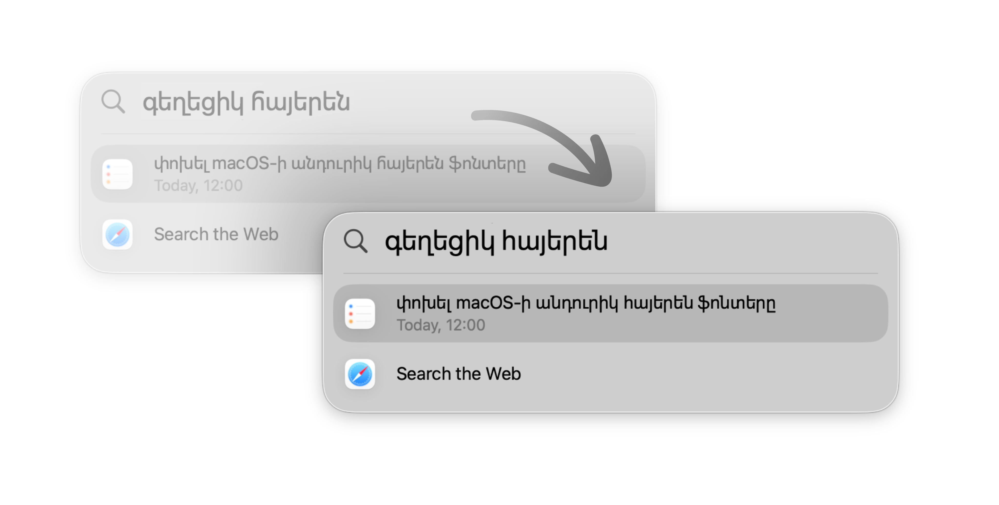
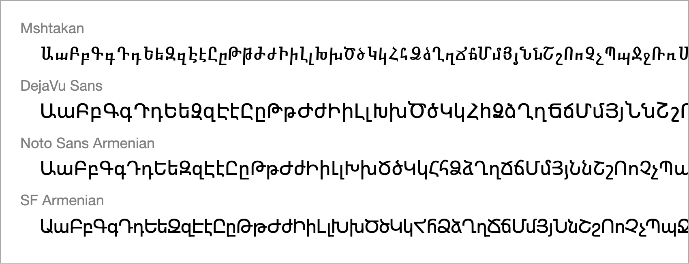

# Replace the macOS System Fonts for Armenian

-Monterey_12_%E2%80%93_Tahoe_26-gold)
[](https://buymeacoffee.com/krmapet?utm_source=github&utm_medium=referral&utm_campaign=sf_noto_replacer&utm_content=badge)

A tool to easily change the macOS system fonts for rendering Armenian — SF Armenian and Noto Sans Armenian — with a replacement font of your liking.

I personally use [Neue Helvetica Armenian](https://www.myfonts.com/collections/neue-helvetica-armenian-font-linotype) by Linotype — the wonderful Armenian supplement of the Neue Helvetica family by [Edik Ghabuzyan](https://www.gheafonts.com/product-category/designers/edik-ghabuzyan/). Neue Helvetica blends beautifully with the interface of macOS because the system default San Francisco has had a strong influence from Helvetica.

## Motivation

The two system fonts used in macOS (and other Apple OSes) to render Armenian text — SF Armenian and Noto Sans Armenian — are *\*cries in agony, rips out hair\**… rather unsightly.

Unfortunately, the Armenian script was never represented in the Apple ecosystem in its whole elegance — starting from the font Mshtakan that made navigating my laptop feel like reading a Soviet-era fiction book, to the crooked earlier versions of DejaVu Sans in iOS (it was so unapologetically grotesque that I admittedly liked it in a [wabi-sabi](https://en.wikipedia.org/wiki/Wabi-sabi) way), to the awful Noto Sans Armenian (sometimes I wonder if I would actually prefer seeing [tofus](https://en.wikipedia.org/wiki/Noto_fonts#Etymology) over reading a paragraph set in this font) and finally to SF Armenian which is… not good either.



That being said, one of the very first things that I always do upon laying my hands on a new Macbook is replace the system fonts. And because hand-crafting the replacement fonts has proved to be a rather tedious task, I thought I'd create this tool to do all the heavy lifting for me (and you).

<h2 id="how-do-you-change-system-fonts">How Do You Even Change the System Fonts?</h2>

Good question — macOS does not provide any standard way to customize typography. In order to change the system fonts, you will need to *lie* to the system about what fonts it is using by replacing the original fonts with replacements modified to have the same names.

For this trick to work, you have to:
1. Engineer your replacement fonts (`SFArmenian.ttf` and `NotoSansArmenian.ttc`) to match exactly the parameters of the original fonts;
2. Create a new bootable volume which contains the replacement fonts in place of the original fonts (inside `/‍System/‍Library/‍Fonts`);
3. 'Bless' the new volume as the boot volume.

It is essential to note that in order to be able to follow these steps, you will unfortunately need to **permanently disable Signed System Volume (SSV)** (and System Integrity Protection (SIP), temporarily) from Recovery mode.

> [!CAUTION]
>
> Disabling Signed System Volume (SSV) comes with risks and makes your machine
> more susceptible to malware, additionally disabling certain features of macOS
> such as FileVault and Apple Pay (see section [Practical Effects of Disabling
> SSV](#practical-effects-of-disabling-ssv)). It might also void your device's
> warranty. Carefully research the risks involved before disabling SSV.
>
> I do not endorse anyone to disable SSV. You should do it at your own risk only
> after you have carefully considered whether the aesthetics of your OS come
> before security for you (I know, I know, being a typography *and* security
> freak myself, 'twas a tough decision for me as well 🙂‍↕️).

The reason for this is that most built-in applications and system UI elements pull the fonts directly from `/System/Library/Fonts`, which is a location protected by SIP/SSV. (Historically, it was possible to place the replacement fonts inside `/Library/Fonts` or even `~/Library/Fonts` and macOS would pick up the replacement fonts everywhere, but that changed sometime after macOS Catalina 10.15; in the more recent versions of macOS, placing the fonts in these locations has hardly any effect.)

## What Does This Tool Do?

In order for the replacement fonts to work, they have to have the exact same parameters of the original fonts — names of instances, number of axes etc. Aside from that, you will need to know a handful of commands to create a new bootable volume and 'bless' it.

This tool does the tedious job of crafting the compatible replacement font files based on your input font for you, and automatically creates a new boot volume with the modified fonts.

> [!CAUTION]
>
> Given the nature of the actions described above, things *may* go wrong during or after the process.
>
> You are advised to run the tool in a virtual machine first that matches your macOS version to see if everything works correctly (and even then there are no guarantees that it will run smoothly on your actual machine). It is also advisable that you back up your data before beginning the process. See also [Known Issues](#known-issues).
>
> This tool comes without warranty of any kind and by using it, you take full responsibility for any damage caused to your machine by use or misuse of the tool. See [Limitation of Liability](#limitation-of-liability).

<h2 id="how-to-use">How to Use</h2>

> [!NOTE]
>
> Before you start, make sure that you have disabled System Integrity Protection (SIP) and Signed System Volume (SSV) from Recovery mode. (NB! **dangerous**, carefully read the section [How Do You Even Change the System Fonts?](#how-do-you-change-system-fonts) above.)

Assuming you want to replace the system fonts for Armenian with a font named `ReplacementFont.ttf`:

1. Download the latest version of the executable `patch-system-fonts` from [Releases]() and place it next to your font file.
2. Open up the Terminal at that folder, then run the following command:

    ```bash
    sudo ./patch-system-fonts ReplacementFont.ttf
    ```

    (Root privileges are required for changing the boot volume.)
3. Read about the potential adverse effects of running the tool and confirm that you still wish to proceeed by typing CONFIRM and pressing Enter.
4. Once you see the message about the boot volume having successfully been changed, restart your computer and you should see the fonts replaced.
5. At this point, you should be good to turn System Integrity Protetion (SIP) back on from Recovery:
   ```bash
   # Turn SIP back on && turn SSV back off
   csrutil enable && csrutil authenticated-root disable
   ```
   (**NB! Don't leave out the second part of the command above** — running `csrutil enable` alone will automatically re-enable SSV, which you still need turned off.)

## Requirements for the Replacement Font

Because SF Armenian and Noto Sans Armenian are both variable fonts (technically Noto is not variable in macOS but a [TrueType collection](https://en.wikipedia.org/wiki/TrueType#Collection) of static instances), your replacement font will need to be a variable font too.

Your replacement font has to be a **variable font with the following axes**:
- **Weight** (`wght`), ranging between the values 1 (minimum), 400 (default) and 1000 (maximum).
  - You must make sure that a 'Regular' master ('wght=400') is the [origin master](https://handbook.glyphsapp.com/variable-font-options/#variable-font-origin) of your font (which means you should have at least 3 masters — 'Regular', 'wght=1', 'wght=1000'), otherwise macOS will pick up the wrong master for regular text in a lot of places.
- (Optional) **Optical size** (`opsz`), ranging between the values 17 (minimum) and 28 (default, maximum).
  - If you are not too particular about the optical size, you can use a font without the `opsz` axis and specify the option `--create-dummy-opsz-axis` to create a no-op `opsz` axis for compatibility (changing the value of this `opsz` axis will have no visual effect).

## Options
<table>
  <thead>
    <tr>
      <th align="left">Argument/Option</th>
      <th align="left">Description</th>
      <th>Required</th>
    </tr>
  </thead>
  <tbody>
    <tr>
      <td>
        <code>source_font</code>
      </td>
      <td>
        <p>The replacement font to generate the effective replacement fonts from.</p>
        <p>The replacement font must satisfy the requirements described in the section <a href="#requirements-for-the-replacement-font">Requirements for the Replacement Font</a>.</p>
      </td>
      <td align="center">✅</td>
    </tr>
    <tr>
      <td>
        <code>--generate-replacements-only</code>
      </td>
      <td>
        <p>When specified, the tool will only generate the effective replacement fonts (<code>SFArmenian.ttf</code> and <code>NotoSansArmenian.ttc</code>) in the current directory, without trying to patch the system fonts.</p>
        <p>When this option is specified, SIP/SSV need not be turned off and <code>sudo</code> is not required.</p>
      </td>
      <td align="center">⛔️</td>
    </tr>
    <tr>
      <td>
        <code>--create-dummy-opsz-axis</code>
      </td>
      <td>
        <p>When specified, creates a 'dummy' optical size (<code>opsz</code>) axis in the replacement font <code>SFArmenian.ttf</code> for compatibility.</p>
        <p>Suitable for cases where the replacement font does not contain an optical size axis and you do not wish to manually set up one.</p>
      </td>
      <td align="center">⛔️</td>
    </tr>
  </tbody>
</table>

## Practical Effects of Disabling SSV

Disabling Signed System Volume (SSV) comes with risks, which you are encouraged to research yourself beforehand. Instead of listing the possible attack vectors that you would be exposing yourself to by disabling SSV, in this section I'd like to cover the more practical effects of disabling SSV that might affect your day-to-day macOS use.

1. **You will need to disable FileVault**. FileVault is the macOS utility program that encrypts your disk, which you generally set up (or not) while setting up your Macbook. Apple requires that FileVault be turned off before you can turn off SSV (running `csrutil authenticated-root disable` will simply fail with a message if you have FileVault on). macOS also won't allow you to turn FileVault back on with SSV disabled ('Internal Error').
    - It is worth noting that this limitation is *not* technical — **it *is* possible** to turn FileVault back on with SSV still off if you are willing to modify your kernel. Check out this [excellent write-up](https://gist.github.com/abitofzoe/8ba21beaff81254e284d474cc85c109d) to learn how to do it (only follow it if you know what you are doing though).
    
      Note that if you want to modify your kernel, you will need to partially disable SIP too (by turning off SIP modules 'Kext Signing' and 'Kernel Integrity Protection' — `csrutil enable --without kext && csrutil authenticated-root disable`), which in itself is another potential attack vector (arguably much harder to abuse, though, than keeping your disk unencrypted).
2. **Apple Pay will stop working (for cards attached directly to Macbook).** Payment requests **will still be forwarded** to other Apple devices tied to your Apple account, e.g. your iPhone or your Apple Watch. Therefore, if you own a second Apple device, this should be a non-issue (I personally never even had my cards attached to my Macbook directly — approving payment requests from my iPhone has always been more convenient for me anyway).

## Known Issues

I will update this list as I come across any further issues with the replaced fonts.

- Chromium-based browsers (Google Chrome, Brave etc.) tend to render Latin gibberish in place of Armenian text in the address bar and tab titles. Actual web content is unaffected and Armenian text renders normally there. (macOS Sequoia 15, Chromium v148.0)

## Troubleshooting

- **I'm seeing a 'Permission denied' error when trying to run the tool.**

  You need execute permissions in order to be able to run the tool. Grant them by running `chmod +x ./patch-system-fonts`, then try running the tool again.

- **I don't like the result. How do I revert back?**

  You can use the following command if you want to revert back to the last Apple-signed bootable snapshot:

  ```bash
  sudo bless --mount / --last--sealed-snapshot
  ```

  You may additionally want to re-enable SSV (and SIP, if still turned off) if you don't need it disabled anymore.

<h2 id="limitation-of-liability">Limitation of Liability</h2>

THIS TOOL IS PROVIDED "AS IS" WITHOUT WARRANTY OF ANY KIND. THIS TOOL MAY DAMAGE OR RENDER YOUR COMPUTER OR DATA INOPERABLE; YOU ACKNOWLEDGE AND ACCEPT ALL RISKS ASSOCIATED WITH USING IT, AND THE AUTHOR(S), CONTRIBUTORS, AND DISTRIBUTORS ARE NOT LIABLE FOR ANY LOSS, DAMAGE, OR INJURY (INCLUDING DATA LOSS, SYSTEM FAILURE, OR OTHER HARM) ARISING FROM USE OR MISUSE OF THIS TOOL; YOU ARE SOLELY RESPONSIBLE FOR BACKUPS, TESTING IN A SAFE ENVIRONMENT, AND ANY CONSEQUENCES OF RUNNING IT.
